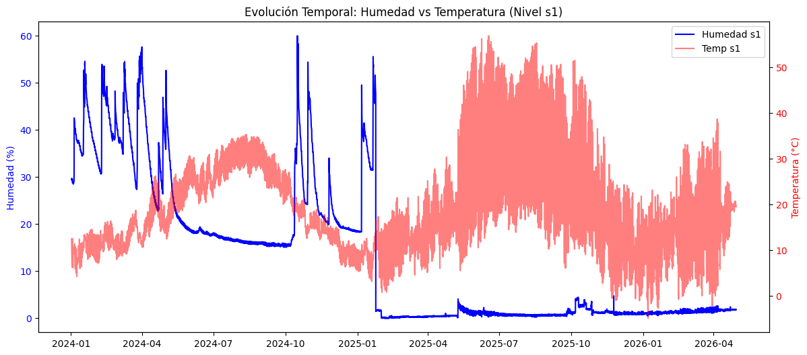
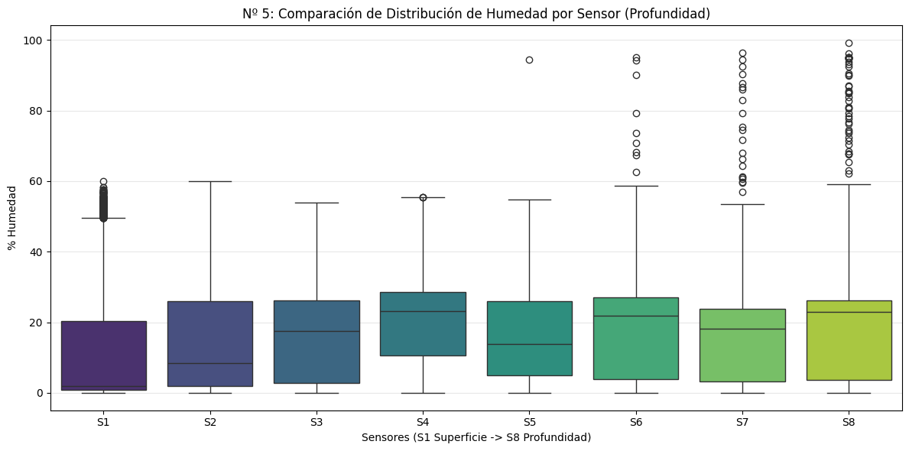
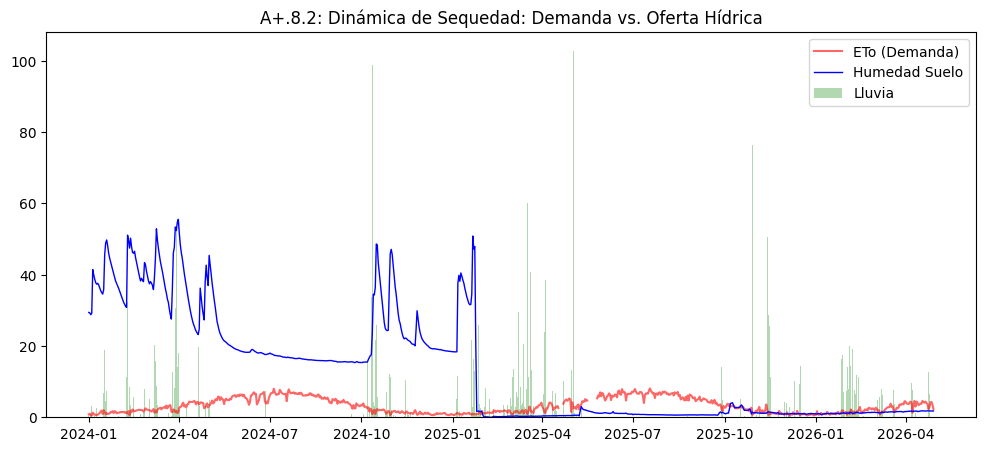
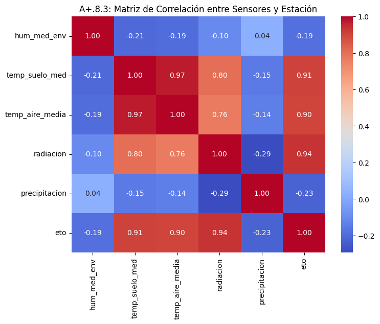
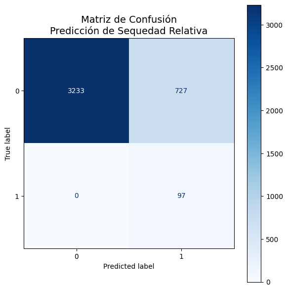

<p align="center">
  
</p>

<p align="center">
  <a href="https://angelpablo2.alwaysdata.net/"></a>
  
  
  
</p>

<p align="center">
  <a href="README.md">Español</a> · <b>English</b>
</p>

---

## What it is

An **EnviroPro** probe records soil moisture and temperature every hour at 8 depths, plus the device's own battery and solar panel. AgroDataLab takes that raw data (January 2024 to April 2026), cleans it, analyses it and turns it into **alerts and recommendations** you can browse in a Django web app.

It also combines the probe with the **IFAPA-RIA** weather station (rain, radiation, evapotranspiration) and trains a model that tries to **predict a dryness alert 24 hours ahead**.

## What's inside

**Data analysis** — [`datos/01_procesamiento_datos.ipynb`](datos/01_procesamiento_datos.ipynb) *(in Spanish)*

- Merging 5 station exports (`.xls` files with a double header, decimal commas and mixed units).
- Cleaning: null interpolation, duplicates, chronological order, impossible values and physical consistency (min ≤ avg ≤ max).
- Full EDA with 10+ visualisations and system health indicators.
- IFAPA-RIA weather data integration and a simplified water balance (P − ETo).
- Alert system: relative dryness, waterlogging, thermal stress, low battery, solar panel, time gaps and out-of-range sensors.
- Decision-tree predictive model evaluated with a chronological split.

**Web platform** — [`agrodatalab_web/`](agrodatalab_web)

- User sign-up and login, with an admin panel.
- Main dashboard plus moisture, temperature, battery and solar panel views with charts.
- CSV import of new data.
- Alert list with relative risk levels.
- Recommendations linked to each alert: create, edit, mark as reviewed or dismissed.

## Some charts

<table>
  <tr>
    <td width="50%"></td>
    <td width="50%"></td>
  </tr>
  <tr>
    <td><sub>Surface sensor moisture and temperature (2024–2026)</sub></td>
    <td><sub>Moisture by depth, from S1 (surface) to S8</sub></td>
  </tr>
  <tr>
    <td></td>
    <td></td>
  </tr>
  <tr>
    <td><sub>Demand (ETo) vs soil moisture and rain</sub></td>
    <td><sub>EnviroPro probe ↔ IFAPA-RIA station correlation</sub></td>
  </tr>
</table>

## The model

**Question:** will there be a relative dryness alert in the next 24 hours?

- **Model:** depth-3 decision tree, chosen on purpose because its rules can be read and explained to a farm technician.
- **Features:** mean soil moisture, mean soil temperature and water balance.
- **Evaluation:** 80 % of the data for training and the most recent 20 % for testing, never mixing past and future.



| Metric (ALERT class) | Result |
|---|---|
| Recall | **1.00** — caught all 97 real alerts |
| Precision | 0.12 — 727 false alarms |
| Overall accuracy | 0.82 |

In practice: it never misses an alert, but it fires too often. As an early irrigation warning it's a reasonable starting point; the next step is cutting down false alarms.

<br clear="right" />

## Run it

```bash
git clone https://github.com/Alpaber/agrodatalab-enviropro.git
cd agrodatalab-enviropro

python -m venv .venv
source .venv/bin/activate        # Windows: .venv\Scripts\activate

pip install -r agrodatalab_web/requirements.txt

cd agrodatalab_web
python manage.py migrate
python manage.py createsuperuser
DJANGO_DEBUG=True python manage.py runserver
```

Open `http://127.0.0.1:8000` and load data from **Importación** using `datos/alertas_django_limpio.csv`.

For the analysis notebook:

```bash
pip install -r requirements-analysis.txt
jupyter lab datos/01_procesamiento_datos.ipynb
```

### Environment variables

| Variable | Purpose | Default |
|---|---|---|
| `DJANGO_SECRET_KEY` | Django secret key (required in production) | dev key |
| `DJANGO_DEBUG` | `True` for local development | `False` |
| `DJANGO_ALLOWED_HOSTS` | Allowed domains, comma-separated | demo + localhost |

## Structure

```text
agrodatalab-enviropro/
├── datos/
│   ├── 01_procesamiento_datos.ipynb   ← cleaning, EDA, alerts and model
│   ├── *_station_data(...).xls        ← raw probe exports
│   ├── Belmez.csv                     ← IFAPA-RIA weather station data
│   ├── agrodata_combined_master.csv   ← merged dataset
│   └── alertas_django_limpio.csv      ← output ready to import into the web app
├── agrodatalab_web/
│   ├── agrodatalab_web/               ← Django project settings
│   └── web/                           ← models, views, forms and templates
├── docs/img/                          ← images for this README
└── requirements-analysis.txt
```

## Next steps

- [ ] Reduce the model's false alarms (more features, threshold tuning, other models)
- [ ] Connect to the IFAPA-RIA API instead of CSV files
- [ ] Automatic ingestion of new probe data
- [ ] Docker and GitHub Actions
- [ ] PyTest tests
- [ ] Report export

## Authors

Final project built as a team by:

- **Pablo Rodríguez** — [@Alpaber](https://github.com/Alpaber)
- **Ángel Guerrero** — [@Dangelcrack](https://github.com/Dangelcrack)

Original repository: [Dangelcrack/agrodatalab-enviropro](https://github.com/Dangelcrack/agrodatalab-enviropro)

> Alerts are **relative risk indicators**, not irrigation orders. Without complete crop, irrigation and soil-type data, the final decision belongs to the agronomy team.

## License

[MIT](LICENSE)
