<p align="center">
  
</p>

<p align="center">
  <a href="https://angelpablo2.alwaysdata.net/"></a>
  
  
  
</p>

<p align="center">
  <b>Español</b> · <a href="README.en.md">English</a>
</p>

---

## Qué es

Una sonda **EnviroPro** mide cada hora la humedad y la temperatura del suelo a 8 profundidades, además de la batería y el panel solar del propio equipo. AgroDataLab coge esos datos en bruto (de enero de 2024 a abril de 2026), los limpia, los analiza y los convierte en **alertas y recomendaciones** que se consultan desde una web hecha con Django.

Además, cruza la sonda con la estación meteorológica de **IFAPA-RIA** (lluvia, radiación, evapotranspiración) y entrena un modelo que intenta **anticipar con 24 horas una alerta de sequedad**.

## Qué incluye

**Análisis de datos** — [`datos/01_procesamiento_datos.ipynb`](datos/01_procesamiento_datos.ipynb)

- Unificación de 5 exportaciones de la estación (formatos `.xls` con cabecera doble, coma decimal, unidades mezcladas).
- Limpieza: interpolación de nulos, duplicados, orden cronológico, valores imposibles y coherencia física (mín ≤ media ≤ máx).
- EDA completo con más de 10 visualizaciones e indicadores del estado del sistema.
- Integración con datos de IFAPA-RIA y balance hídrico simplificado (P − ETo).
- Sistema de alertas: sequedad relativa, encharcamiento, estrés térmico, batería baja, panel solar, huecos temporales y sensor fuera de rango.
- Modelo predictivo con árbol de decisión y evaluación con separación cronológica.

**Plataforma web** — [`agrodatalab_web/`](agrodatalab_web)

- Registro e inicio de sesión de usuarios, con panel de administración.
- Dashboard general y vistas de humedad, temperatura, batería y panel solar con gráficas.
- Importación de nuevos datos desde CSV.
- Listado de alertas con nivel de riesgo relativo.
- Recomendaciones asociadas a cada alerta: crear, editar, marcar como revisada o descartada.

## Algunas gráficas

<table>
  <tr>
    <td width="50%"></td>
    <td width="50%"></td>
  </tr>
  <tr>
    <td><sub>Humedad y temperatura del sensor superficial (2024–2026)</sub></td>
    <td><sub>Humedad por profundidad, de S1 (superficie) a S8</sub></td>
  </tr>
  <tr>
    <td></td>
    <td></td>
  </tr>
  <tr>
    <td><sub>Demanda (ETo) frente a humedad del suelo y lluvia</sub></td>
    <td><sub>Correlación sonda EnviroPro ↔ estación IFAPA-RIA</sub></td>
  </tr>
</table>

## El modelo

**Pregunta:** ¿va a haber una alerta de sequedad relativa en las próximas 24 horas?

- **Modelo:** árbol de decisión de profundidad 3. Elegido a propósito porque sus reglas se pueden leer y explicar a un técnico agrícola.
- **Variables:** humedad media, temperatura media del suelo y balance hídrico.
- **Evaluación:** 80 % de los datos para entrenar y el 20 % más reciente para probar, sin mezclar pasado y futuro.


| Métrica (clase ALERTA) | Resultado |
|---|---|
| Sensibilidad (recall) | **1.00** — detectó las 97 alertas reales |
| Precisión | 0.12 — 727 falsas alarmas |
| Exactitud global | 0.82 |

En la práctica: no se le escapa ninguna alerta, pero salta demasiadas veces. Para un primer aviso de riego es un punto de partida razonable. El siguiente paso es reducir las falsas alarmas.

<br clear="right" />

## Cómo ejecutarlo

```bash
git clone https://github.com/Alpaber/agrodatalab-enviropro.git
cd agrodatalab-enviropro

python -m venv .venv
source .venv/bin/activate        # Windows: .venv\Scripts\activate

pip install -r agrodatalab_web/requirements.txt

cd agrodatalab_web
python manage.py migrate
python manage.py createsuperuser
DJANGO_DEBUG=True python manage.py runserver
```

Abre `http://127.0.0.1:8000` y carga datos desde **Importación** con `datos/alertas_django_limpio.csv`.

Para el notebook de análisis:

```bash
pip install -r requirements-analysis.txt
jupyter lab datos/01_procesamiento_datos.ipynb
```

### Variables de entorno

| Variable | Para qué | Por defecto |
|---|---|---|
| `DJANGO_SECRET_KEY` | Clave secreta de Django (obligatoria en producción) | clave de desarrollo |
| `DJANGO_DEBUG` | `True` para desarrollo local | `False` |
| `DJANGO_ALLOWED_HOSTS` | Dominios permitidos, separados por comas | demo + localhost |

## Estructura

```text
agrodatalab-enviropro/
├── datos/
│   ├── 01_procesamiento_datos.ipynb   ← limpieza, EDA, alertas y modelo
│   ├── *_station_data(...).xls        ← exportaciones originales de la sonda
│   ├── Belmez.csv                     ← datos de la estación IFAPA-RIA
│   ├── agrodata_combined_master.csv   ← dataset unificado
│   └── alertas_django_limpio.csv      ← salida lista para importar en la web
├── agrodatalab_web/
│   ├── agrodatalab_web/               ← configuración del proyecto Django
│   └── web/                           ← modelos, vistas, formularios y plantillas
├── docs/img/                          ← imágenes de este README
└── requirements-analysis.txt
```

## Próximos pasos

- [ ] Reducir falsas alarmas del modelo (más variables, ajuste del umbral, otros modelos)
- [ ] Conectar con la API de IFAPA-RIA en lugar de usar CSV
- [ ] Ingesta automática de nuevos datos de la sonda
- [ ] Docker y GitHub Actions
- [ ] Tests con PyTest
- [ ] Exportación de informes

## Autores

Proyecto final desarrollado en equipo por:

- **Pablo Rodríguez** — [@Alpaber](https://github.com/Alpaber)
- **Ángel Guerrero** — [@Dangelcrack](https://github.com/Dangelcrack)

Repositorio original: [Dangelcrack/agrodatalab-enviropro](https://github.com/Dangelcrack/agrodatalab-enviropro)

> Las alertas son indicadores de **riesgo relativo**, no órdenes de riego. Sin datos completos de cultivo, sistema de riego y tipo de suelo, la decisión final corresponde al equipo agrícola.

## Licencia

[MIT](LICENSE)
